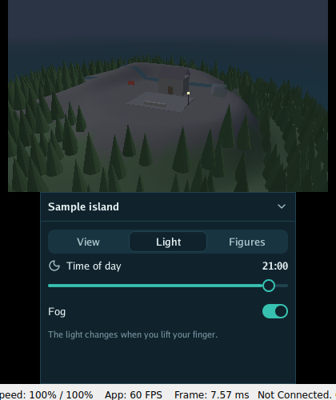

<p align="center"></p>

# Go for 3DS

> **Note:** this project was written with an AI assistant and is pending thorough review. See the [AI disclosure](#ai-disclosure).

Go programs on the **Nintendo 3DS**, as homebrew for the Homebrew Launcher. The drawing is
[Go Renderer](https://github.com/akrck02/go-renderer)'s (`ctr`, through citro3d); this repository
holds the rest of the platform: the program loop, a
[Go UI](https://github.com/akrck02/go-ui) interface on the bottom screen, and an explorer of the
sample island.

<p align="center">
  
</p>

```bash
tinygo build -target=nintendo3ds -o explorer.3dsx ./cmd/explorer
```

It needs a TinyGo with the `nintendo3ds` target and devkitPro's 3DS libraries. Everything is in
[docs/](docs/1-overview.md); to start, [the 3DS quest](docs/2-the-quest.md).

## License

MIT, in [LICENSE](LICENSE). A `.3dsx` built from this repository also carries TinyGo, libctru,
citro3d, newlib and Go modules; their notices are in [THIRD_PARTY_NOTICES.md](THIRD_PARTY_NOTICES.md),
to keep next to any `.3dsx` you share.

## AI disclosure

I write most of my code by hand, so I want to be clear about this project: **it was written by an
AI assistant (Claude, by Anthropic) under my direction.** Every commit made this way carries a
`Co-Authored-By: Claude` line.

**Status: pending thorough review.** The code compiles and its tests pass, but I have not yet
reviewed it line by line. Treat it as a working draft, not as code I vouch for.
