# The 3DS quest

Put a Go program on a Nintendo 3DS, one level at a time. Each level teaches one piece of Go for 3DS
and ends with a `.3dsx` you can run in an emulator or on the console.

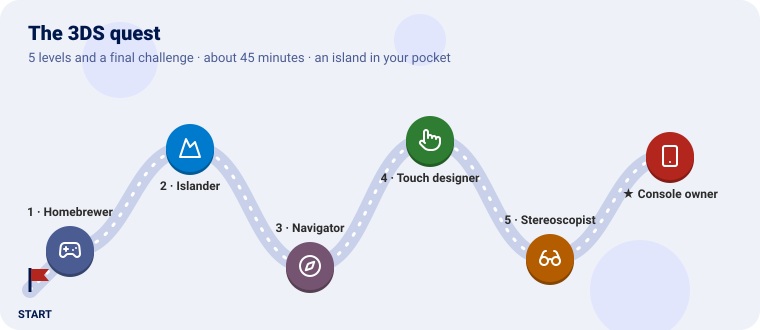

We start with words on the bottom screen, then put Go Renderer's sample island on the top one,
turn it with the circle pad, add a Go UI panel to touch below, switch on the real 3D, and finally
copy it to an SD card.

---

Every level has the same shape: **the idea** (explained with something from everyday life), **the
code**, a **checkpoint** to know it works, and an optional **bonus**.

---

## Before you start

You need:

| | Why | Where |
|---|---|---|
| **TinyGo with the `nintendo3ds` target** | Go does not build for the 3DS; this fork of TinyGo does | [tinygo-3ds](https://github.com/akrck02/tinygo-3ds), branch `feature/3ds`, built against a system LLVM (its `NINTENDO3DS.md`) |
| **devkitPro's 3DS packages** | The console's libraries: libctru, citro3d, 3dstools | devkitARM in `/opt/devkitpro` ([devkitpro.org](https://devkitpro.org/wiki/Getting_Started)) |
| **An emulator** (optional) | To try a program without the console | [Azahar](https://azahar-emu.org) |

Clone Go for 3DS and make a module for the quest beside it. Go for 3DS's `go.mod` pins the versions of
Go Renderer and Go UI that draw on the console; copy its `replace` line:

```sh
git clone https://github.com/akrck02/go-3ds
mkdir homebrew && cd homebrew
go mod init example.com/homebrew
go mod edit -require github.com/akrck02/go-3ds@v0.0.0 -replace github.com/akrck02/go-3ds=../go-3ds
grep '^replace github.com/akrck02/go-renderer' ../go-3ds/go.mod >> go.mod
```

Build any level, and open it:

```sh
go mod tidy
tinygo build -target=nintendo3ds -o hello.3dsx ./hello
azahar hello.3dsx
```

Every file starts with `//go:build nintendo3ds`: these programs only build for the console.

---

## Level 1 · The Homebrewer

| Mission | Pieces | Time |
|---|---|---|
| A colour above, words below, and the buttons you press | `ctr.Open`, `OpenBottomConsole`, `app.Run`, frames | 10 min |

#### The idea

A game console runs a **flip book**: sixty pages a second, each drawn and then shown. Your program
is called once a page (`app.Run`'s function), reads the buttons, draws, and hands the page over
(`ctr.EndFrame`), which waits for the screen.

Homebrew is a program the console was not sold with, opened from the **Homebrew Launcher**.

#### Build it

`hello/main.go`:

```go
//go:build nintendo3ds

// Your first homebrew: a colour on the top screen, words on the bottom one, and the buttons you
// press.
package main

import (
	"fmt"

	"github.com/akrck02/go-3ds/app"
	"github.com/akrck02/go-renderer/ctr"
	"github.com/akrck02/go-renderer/input"
)

// sea is the top screen's colour, 0xRRGGBBAA.
const sea = 0x2a6f97ff

func main() {
	screen, err := ctr.Open() // the graphics system and the top screen
	if err != nil {
		println(err.Error())
		return
	}
	defer screen.Close()
	ctr.OpenBottomConsole() // the bottom screen becomes a terminal: what the program prints goes there
	fmt.Println("Hello from Go!")
	fmt.Println("Press A, B or the cross. START ends.")

	keys := []input.Key{input.KeyEnter, input.KeyEscape, input.KeyUp, input.KeyDown, input.KeyLeft, input.KeyRight}
	names := []string{"A", "B", "up", "down", "left", "right"}
	app.Run(func(frame app.Frame) bool {
		for index, key := range keys {
			if frame.Input.Pressed(key) {
				fmt.Println("pressed", names[index])
			}
		}
		ctr.BeginFrame()
		screen.Clear(sea)
		ctr.EndFrame() // waits for the screen: one frame each sixtieth of a second
		return true    // false would end the program
	})
}
```

`ctr.Open` starts the graphics: always first. `app.Run` reads the controls into Go Renderer's
`input.State`, the same as on a desktop: **A** is Enter, **B** is Escape, the cross is the arrows.

#### Checkpoint

The top screen is sea blue; the bottom one says *Hello from Go!*, and a line for every button you
press. **START** ends the program.

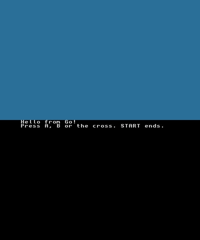

#### Bonus (optional): count the frames

<details>
<summary>🔓 Show the solution</summary>

<pre><code>frames := 0
app.Run(func(frame app.Frame) bool {
	frames++
	if frames%60 == 0 {
		fmt.Println(frames/60, "seconds")
	}
	…</code></pre>

On the console it counts real seconds: sixty frames each.

</details>

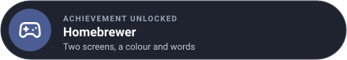

---

## Level 2 · The Islander

| Mission | Pieces | Time |
|---|---|---|
| The sample island in 3D on the top screen | `ctr.NewSceneRenderer`, `Draw`, a camera | 5 min |

#### The idea

Go Renderer describes a scene the same way everywhere; only the **painter** changes. On the
desktop it is OpenGL or Metal; on the 3DS it is citro3d, the console's own, through `ctr`. The
scene, the camera and the sample island are the same as on a computer.

#### Build it

`island/main.go`:

```go
//go:build nintendo3ds

// The sample island on the top screen, seen from a camera that stands still.
package main

import (
	"github.com/akrck02/go-3ds/app"
	"github.com/akrck02/go-renderer/ctr"
	"github.com/akrck02/go-renderer/graphics"
	"github.com/akrck02/go-renderer/models"
	"github.com/akrck02/go-renderer/scene/sample"
)

func main() {
	screen, err := ctr.Open()
	if err != nil {
		println(err.Error())
		return
	}
	defer screen.Close()
	renderer, err := ctr.NewSceneRenderer(screen) // draws a go-renderer scene through citro3d
	if err != nil {
		println(err.Error())
		return
	}

	world := sample.Island() // the same made-up island the desktop viewer opens with -sample island
	view := models.Camera{
		Position: graphics.Vec4{300, 220, 300, 1}, // metres east, up and south of the middle
		Target:   graphics.Vec4{0, 0, 0, 1},
		Up:       graphics.Vec4{0, 1, 0, 0},
		Far:      20000,
	}
	app.Run(func(frame app.Frame) bool {
		renderer.Draw(world, view) // begins the frame, draws and shows it
		return true
	})
}
```

#### Checkpoint

The island in the middle of the sea, with its forest and village, under a hazy sky.

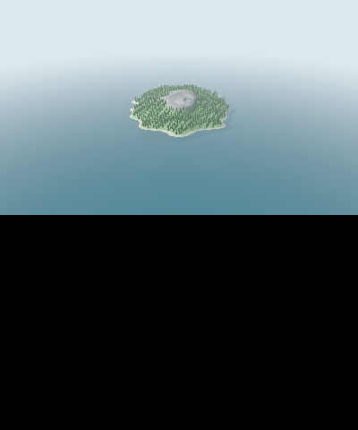

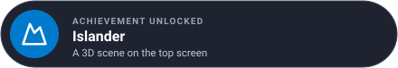

Learn more: [Go Renderer on the 3DS](https://github.com/akrck02/go-renderer/blob/feature/3ds/docs/3ds.md)

---

## Level 3 · The Navigator

| Mission | Pieces | Time |
|---|---|---|
| Turn round the island with the circle pad | `frame.Reading.Circle`, `camera.Orbit` | 6 min |

#### The idea

The **circle pad** is a joystick: it says how far it is pushed each way, from −1 to 1. The orbit
camera is the desktop viewer's: it circles round a point, and here the pad turns it instead of the
mouse. The cross and **L**, **R** already speak the camera's language: arrows and minus, plus.

#### Build it

```go
//go:build nintendo3ds

// The island on the top screen, turned with the circle pad and the cross, nearer and further with
// L and R.
package main

import (
	"github.com/akrck02/go-3ds/app"
	"github.com/akrck02/go-renderer/camera"
	"github.com/akrck02/go-renderer/ctr"
	"github.com/akrck02/go-renderer/graphics"
	"github.com/akrck02/go-renderer/input"
	"github.com/akrck02/go-renderer/models"
	"github.com/akrck02/go-renderer/scene/sample"
)

func main() {
	screen, err := ctr.Open()
	if err != nil {
		println(err.Error())
		return
	}
	defer screen.Close()
	renderer, err := ctr.NewSceneRenderer(screen)
	if err != nil {
		println(err.Error())
		return
	}
	world := sample.Island()
	orbit := camera.NewOrbit(graphics.Vec4{0, 0, 0, 1}, 450) // the desktop viewer's orbit camera
	orbit.Pitch = 0.5
	orbit.Ground = world.GroundHeight // it never goes under the ground
	view := models.Camera{Far: 20000}

	app.Run(func(frame app.Frame) bool {
		// The circle pad, from −1 to 1 each way: turn left and right, tilt up and down.
		circleX, circleY := frame.Reading.Circle()
		orbit.Yaw -= circleX * 1.8 * frame.Seconds
		orbit.Pitch += circleY * 1.2 * frame.Seconds
		// The cross is the arrows and L, R are minus and plus, which the orbit already reads; the
		// touch screen is left out, so a finger does not turn the island.
		keys := *frame.Input
		keys.SetButton(input.MouseLeft, false)
		orbit.Update(&keys, frame.Seconds, &view)

		renderer.Draw(world, view) // begins the frame, draws and shows it
		return true
	})
}
```

#### Checkpoint

The same island, and now the circle pad turns round it and tilts it, the cross does too, **L** and
**R** go further and nearer. The camera never sinks under the ground.

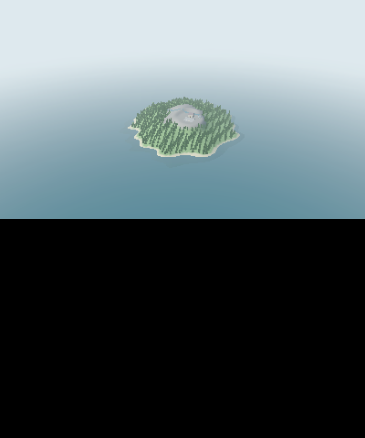

#### Bonus (optional): a slower, gentler turn

<details>
<summary>🔓 Show the solution</summary>

Halve the speeds: `circleX * 0.9` and `circleY * 0.6`.

</details>

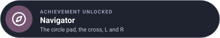

---

## Level 4 · The Touch designer

| Mission | Pieces | Time |
|---|---|---|
| A Go UI panel on the touch screen: the time of day | `bottom.New`, `Paint`, both screens in one frame | 10 min |

#### The idea

The bottom screen is a **touch screen**, so it is the pointer: a finger or the stylus presses
Go UI's buttons and drags its sliders exactly as a mouse would. `bottom` lays a Go UI interface out
there in a theme made for fingers, in the sea's colours.

Both screens are drawn in **one frame**: between `ctr.BeginFrame` and `ctr.EndFrame`, the island
with `PaintStereo` (Draw would begin and end a frame of its own) and then the panel.

#### Build it

```go
//go:build nintendo3ds

// The island above, and below a go-ui panel touched with a finger: the time of day.
package main

import (
	"fmt"
	"math"

	"github.com/akrck02/go-3ds/app"
	"github.com/akrck02/go-3ds/bottom"
	"github.com/akrck02/go-renderer/camera"
	"github.com/akrck02/go-renderer/ctr"
	"github.com/akrck02/go-renderer/graphics"
	"github.com/akrck02/go-renderer/input"
	"github.com/akrck02/go-renderer/models"
	"github.com/akrck02/go-renderer/scene"
	"github.com/akrck02/go-renderer/scene/sample"
	ui "github.com/akrck02/go-ui"
)

func main() {
	screen, err := ctr.Open()
	if err != nil {
		println(err.Error())
		return
	}
	defer screen.Close()
	renderer, err := ctr.NewSceneRenderer(screen)
	if err != nil {
		println(err.Error())
		return
	}
	panel, err := bottom.New(bottom.Theme()) // go-ui on the bottom screen, in a theme for fingers
	if err != nil {
		println(err.Error())
		return
	}
	world := sample.Island()
	orbit := camera.NewOrbit(graphics.Vec4{0, 0, 0, 1}, 450)
	orbit.Pitch = 0.5
	orbit.Ground = world.GroundHeight
	view := models.Camera{Far: 20000}
	hour, litHour := float32(10), float32(-1)

	app.Run(func(frame app.Frame) bool {
		circleX, circleY := frame.Reading.Circle()
		orbit.Yaw -= circleX * 1.8 * frame.Seconds
		orbit.Pitch += circleY * 1.2 * frame.Seconds
		keys := *frame.Input
		keys.SetButton(input.MouseLeft, false)
		orbit.Update(&keys, frame.Seconds, &view)

		// Both screens in one frame: Paint* draws inside it, where Draw would begin and end its own.
		ctr.BeginFrame()
		renderer.PaintStereo(world, view, 0, 0) // one picture: no separation between the eyes
		panel.Paint(frame.Input, func(context *ui.Context) {
			context.Box(ui.Layout{Direction: ui.Vertical, Width: ui.Grow(), Padding: ui.Pad(16), Gap: 12}, func() {
				context.Heading("The island")
				context.Label(fmt.Sprintf("%02d:00", int(hour)))
				context.SliderStep("hour", &hour, 0, 23, 1)
				if context.Button("Noon") {
					hour = 12
				}
			})
		})
		ctr.EndFrame()

		// A new light works the island's colours out again on the processor: only once the finger
		// leaves the screen, or every step of a drag would stutter.
		if hour != litHour && !frame.Input.Button(input.MouseLeft) {
			light(world, hour)
			litHour = hour
		}
		return true
	})
}

// light puts the sun where it is at an hour: rising in the east at six, highest at noon, setting
// in the west at six in the evening.
func light(world *scene.Scene, hour float32) {
	angle := float64(hour-6) / 12 * math.Pi
	elevation := math.Sin(angle) * 1.1
	sun := graphics.Vec4{float32(-math.Cos(angle) * math.Cos(elevation)), float32(math.Sin(elevation)), float32(-0.35 * math.Cos(elevation)), 0}
	world.Environment.SunDirection = sun.Normalize()
}
```

The light is worked out again only once the finger leaves the screen: on the 3DS the island's
colours are computed on the processor for each light, which would make a drag stutter.

#### Checkpoint

Below, *The island*, the hour and a slider: drag it and let go, and the island turns to evening or
morning; **Noon** brings back the midday sun.


#### Bonus (optional): fog

<details>
<summary>🔓 Show the solution</summary>

<pre><code>fog := true
…
if context.Toggle("Fog", &amp;fog) {
	world.Environment.FogNear, world.Environment.FogFar = 250, 900
	if !fog {
		world.Environment.FogFar = 0
	}
}</code></pre>

</details>

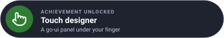

Learn more: [Go UI on the 3DS](https://github.com/akrck02/go-ui/blob/feature/3ds/docs/3ds.md)

---

## Level 5 · The Stereoscopist

| Mission | Pieces | Time |
|---|---|---|
| Real 3D with the slider | `ctr.Slider3D`, `PaintStereo` with a separation | 4 min |

#### The idea

Your eyes are about **six centimetres apart**, and each sees the world a little differently; the
brain makes depth of the difference. The 3DS's top screen shows each eye its own picture. The
renderer draws the scene twice, from two eyes a little apart, as far apart as the **3D slider**
on the console's side says.

#### Build it

Only the frame changes from level 4:

```go
		// The 3D slider, from 0 to 1, sets how far apart the two eyes stand: a share of the
		// distance to what the camera looks at. At 0 the screen shows one picture.
		separation := ctr.Slider3D() * float32(orbit.Distance) * 0.03

		ctr.BeginFrame()
		renderer.PaintStereo(world, view, separation, float32(orbit.Distance))
```

What lies at the focal distance (the point the camera turns round) sits on the screen; nearer
things come out of it, further ones go in.

#### Checkpoint

With the slider down, the same picture as before. Push it up on a console: the island stands out
of the screen. (An emulator shows one eye.)

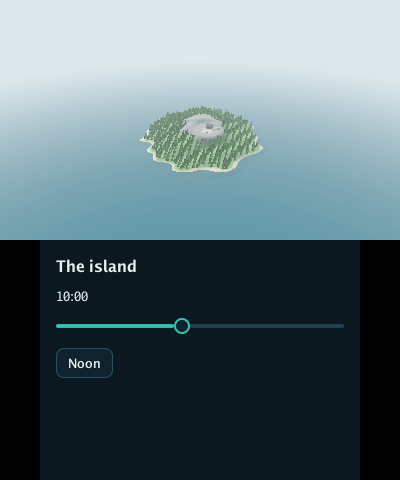

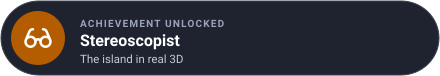

---

## Final challenge · Console owner

Run your program on a real New 3DS: copy it to the SD card, open it from the Homebrew Launcher,
and share it with the notices it must carry.

> **Hint:** the Homebrew Launcher lists the `.3dsx` files in `/3ds/` on the SD card. A `.3dsx`
> carries TinyGo, libctru, citro3d and newlib: their licences go with it.

<details>
<summary>🔓 Show the solution</summary>

1. `tinygo build -target=nintendo3ds -o island.3dsx ./island`
2. Copy `island.3dsx` to `/3ds/` on the SD card (or send it over Wi-Fi with `3dslink`, from
   devkitPro's 3dstools, while the Launcher waits with **Y**).
3. Open the Homebrew Launcher and choose it.
4. To share it, put Go for 3DS's [THIRD_PARTY_NOTICES.md](../THIRD_PARTY_NOTICES.md) next to it.

On a New 3DS XL the island runs at 60 frames a second, in 3D with the slider.

</details>

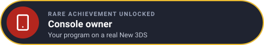

---

## Well done

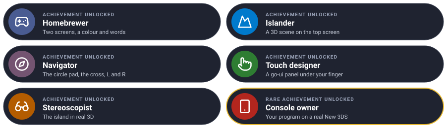

You built Go for a handheld console: two screens, a 3D scene, its controls, an interface under
your finger, and real 3D.

### Ideas to keep going

| Idea | Difficulty | Hint |
|---|---|---|
| Fly to places on the island | ⭐ | `cmd/explorer` eases the camera to a point chosen on its panel |
| A map of the island on the panel | ⭐⭐ | `cmd/explorer`'s `islandMap`: a `draw2d.Image` drawn from `world.GroundHeight` |
| A Go UI application, unchanged | ⭐⭐ | Go UI's `window.Run` on its `feature/3ds` branch puts the scene above and the interface below |
| Sound | ⭐⭐ | [Go Sound](https://github.com/akrck02/go-sound) plays through the DSP; it needs `/3ds/dspfirm.cdc` |

## Troubleshooting

| You see | Why, and what to do |
|---|---|
| *An exception occurred … Undefined Instruction*, PC 0 | Something of `ctr` was used before `ctr.Open`, such as `OpenBottomConsole`: open first |
| *Exception Type: Break* when drawing both screens | `Draw` begins and ends its own frame: inside `BeginFrame` … `EndFrame`, use `PaintStereo` |
| `build constraints exclude all Go files` with `go build` | These programs are for TinyGo's `nintendo3ds` target only |
| Works in the emulator, stops on the console | The emulator forgives reads of unmapped memory: run it with Go for 3DS's `tools/run-in-azahar.sh`, which warns of them |
| A drag on the panel stutters | Work done every frame on the processor: do it when the finger leaves (`!frame.Input.Button(input.MouseLeft)`) |

---

[← All the documentation](1-overview.md)
