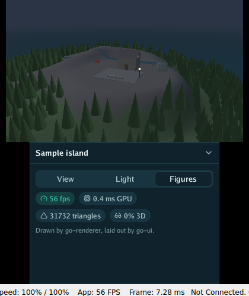

# What is where

The packages of Go for 3DS, the explorer it comes with, what you need to build for the console, and what was checked on a real New 3DS XL.


## What is where

| Piece | What it does |
|---|---|
| `bottom` | A Go UI interface on the bottom screen: Go UI lays it out, Go Renderer's `ctr.FlatRenderer` paints it, the touch screen is its pointer. `bottom.Theme` is Go UI's dark theme made for 320 × 240 pixels a finger touches, in the sea's colours. |
| `app` | The program loop: the New 3DS's fast clock, the controls into the input state every frame (Go Renderer's `ctr.Controls`: the cross as arrows, L and R as minus and plus, A Enter, B Escape and back, the touch screen as the pointer), START or the HOME menu to stop. |
| `cmd/explorer` | The sample island on the top screen, in 3D with the slider, and a Go UI panel on the bottom one: places to fly to, the time of day and the fog, and how fast frames go. The circle pad or the cross turn the camera, L and R move it away and closer. |
| `tools/run-in-azahar.sh` | Runs a `.3dsx` in the Azahar emulator without a screen (under Xvfb) and prints what the program wrote to the debug log; it also warns about reads and writes of unmapped memory, which stop a program on the console but not in the emulator. |

## The explorer

<p align="center">
  
  
  
</p>

The map is a picture the explorer draws when it starts, from the island's heights
(`world.GroundHeight`): coloured by height like a chart, shaded as if lit from the north-west,
with a dot on the village and one on the peak. Flying to a place eases the camera there in under
a second. The time of day changes the light
when the finger leaves the screen: a new light works the meshes' colours out again on the
processor, which would make every step of a drag stutter.

Both screens are drawn in one frame: the island with `ctr.SceneRenderer.PaintStereo`, the panel
with `bottom.Interface.Paint`, between `ctr.BeginFrame` and `ctr.EndFrame`.

A Go UI program with `window.Run` can also run on the console unchanged: Go UI's own window for
the 3DS (its `feature/3ds` branch) puts the scene above and the interface below, and SELECT swaps
them. The packages here are for programs with a loop of their own, like the explorer.

## What you need

- A TinyGo with the `nintendo3ds` target (a fork of TinyGo, `feature/3ds`), built against a
  system LLVM.
- devkitPro's 3DS packages (devkitARM, libctru, citro3d, 3dstools) in `/opt/devkitpro`.

```bash
tinygo build -target=nintendo3ds -o explorer.3dsx ./cmd/explorer
```

Copy the `.3dsx` to `/3ds/` on the SD card and open it from the Homebrew Launcher.

## What was checked

On a New 3DS XL: the explorer at 60 frames a second, steady while the camera moves fast (GPU about
6 ms a frame, processor under 1 ms), in 3D with the slider. Its Go UI panel is checked in the
Azahar emulator: tabs, buttons, the slider and the switch answer clicks on the bottom screen.

## Before writing a larger program

The explorer is small. A program with a large scene and an interface of its own (a few hundred
things on screen, data read at start) ran into the console's limits first, and these were the
ways through. Each repository keeps the part that is its own:

| Where | What it says |
|---|---|
| tinygo-3ds, `NINTENDO3DS.md` | How the heap is used, what makes garbage in TinyGo that would not in Go, how to find where it comes from, and the New 3DS's fast mode |
| Go Renderer, `docs/3ds.md` | Keeping a frame short: what the overlay costs, pixel-art shapes, the scene's drawing in both eyes, waiting for the GPU |
| Go UI, `docs/3ds.md` | Writing an interface for the console: frame times, themes, closures, texts, game looks, the buttons |

In short: measure on the console by phase, make no garbage in a steady frame, and keep what
changes every frame small.

## Not yet

- The second core and the New 3DS's C-stick.
- Sound, files on the SD card (TinyGo's `os` has no file system there yet), the keyboard applet.
